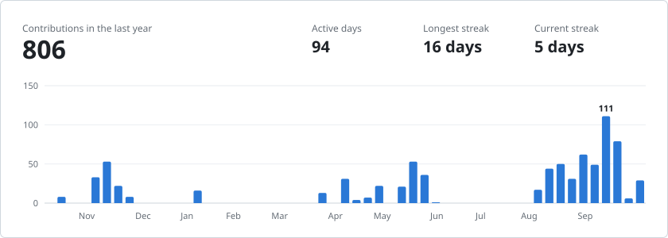
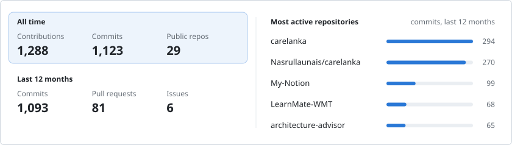
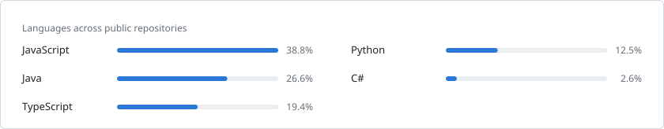

### Lochana Dahanayake

Software engineering undergraduate at SLIIT, based in Colombo. Most of what I build is backend work in Java and Spring Boot. Outside of that I work on web apps, applied machine learning, and small security tools.

[Portfolio](https://lochd-my-portfolio.vercel.app/) · [LinkedIn](https://www.linkedin.com/in/lochana-dahanayake/)

 

<picture>
  <source media="(prefers-color-scheme: dark)" srcset="assets/education-dark.svg">
  
</picture>

<picture>
  <source media="(prefers-color-scheme: dark)" srcset="assets/activity-dark.svg">
  
</picture>

<picture>
  <source media="(prefers-color-scheme: dark)" srcset="assets/stats-dark.svg">
  
</picture>

<picture>
  <source media="(prefers-color-scheme: dark)" srcset="assets/languages-dark.svg">
  
</picture>

#### Selected work

| Project | What it does | Built with |
| --- | --- | --- |
| [Phish-Hawk v2](https://github.com/loch214/phish-hawk-v2) | Flags phishing emails using a custom-trained model served as a separate service | Spring Boot, PyTorch |
| [Lens Lock](https://github.com/loch214/lens-lock-metadata-tool) | Shows and strips hidden metadata (GPS, device info) from images | Spring Boot, React |
| [Car brand detection API](https://github.com/loch214/car-brand-detection-API) | Recognises 19 car brands from photos with a custom YOLOv5 model | YOLOv5, FastAPI |
| [CourseWeb notifications filter](https://github.com/loch214/courseweb-notifications-filter) | Shows only the SLIIT CourseWeb notices meant for your group | Chrome extension, Outlook rules |
| [LearnMate](https://github.com/loch214/LearnMate-WMT) | Mobile management system for an educational institute | React Native, Node.js, MongoDB |

#### Stack

**Backend** &nbsp; Java · Spring Boot · Node.js · ASP.NET Core 
**Frontend** &nbsp; TypeScript · React · Next.js · React Native 
**Data** &nbsp; MySQL · PostgreSQL · MongoDB 
**ML** &nbsp; Python · PyTorch · scikit-learn
